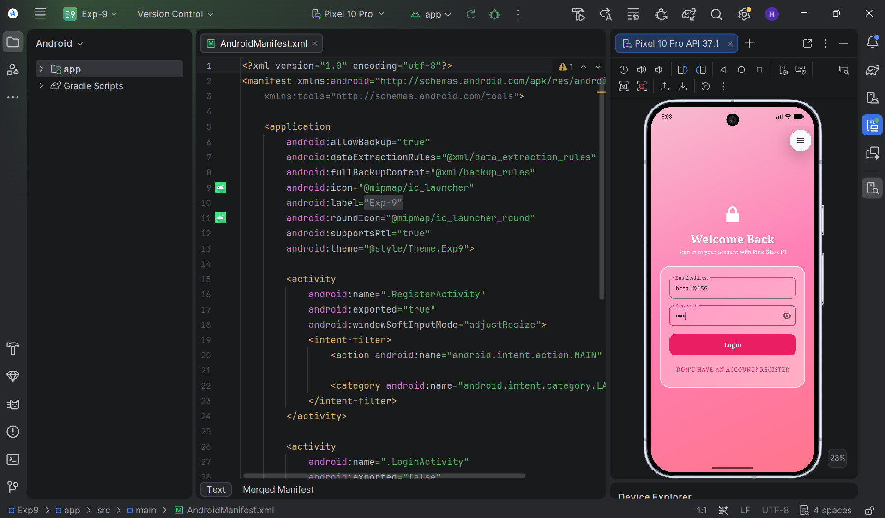
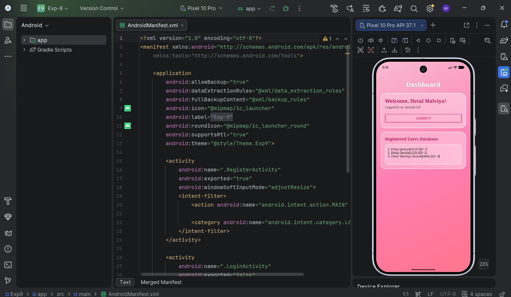
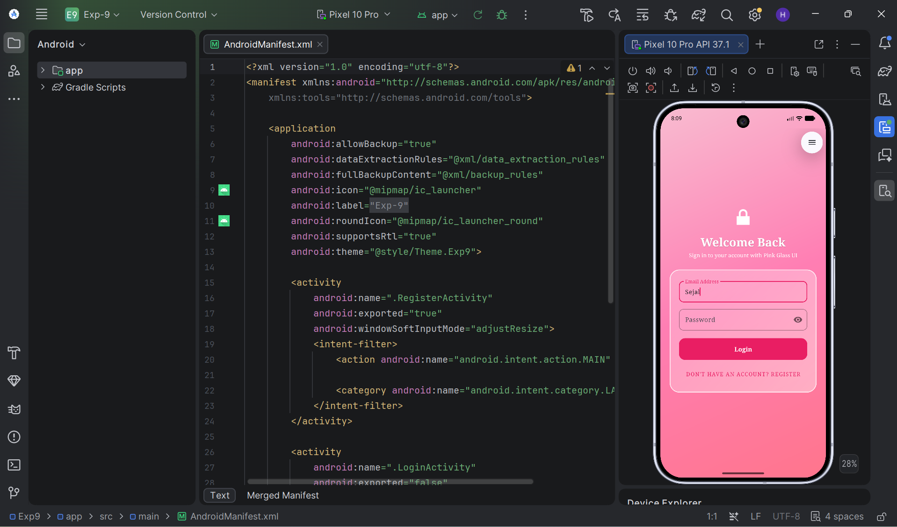
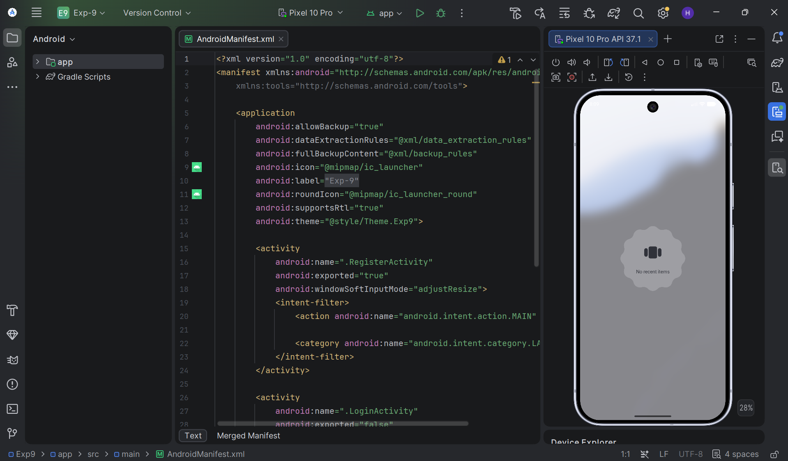

# Experiment 9: Android Data Persistence Application

An Android application demonstrating persistent data storage using **SQLite Database** (`SQLiteOpenHelper`) for user authentication and CRUD operations, combined with **SharedPreferences** for session tracking, key-value storage, and persistent draft auto-restoration across app restarts.

---

## System Structure

```
Exp9/
├── app/
│   ├── src/
│   │   ├── main/
│   │   │   ├── java/com/example/exp_9/
│   │   │   │   ├── DatabaseHelper.kt      # SQLite OpenHelper handling DB schema & CRUD logic
│   │   │   │   ├── RegisterActivity.kt    # User registration & draft auto-saving
│   │   │   │   ├── LoginActivity.kt       # Credential validation & session creation
│   │   │   │   ├── HomeActivity.kt        # User dashboard & registered users database viewer
│   │   │   │   └── MainActivity.kt        # SharedPreferences & SQLite direct testing interface
│   │   │   ├── res/
│   │   │   │   ├── drawable/              # Frosted Glass UI backgrounds & custom drawables
│   │   │   │   ├── layout/                # UI XML Layouts (register, login, home, main)
│   │   │   │   └── values/                # Themes, colors, strings
│   │   │   └── AndroidManifest.xml        # Application manifest & activity launch config
```

---

## Key Code Implementation

### 1. SQLite Database Helper (`DatabaseHelper.kt`)
```kotlin
class DatabaseHelper(context: Context) : SQLiteOpenHelper(context, "UserDB.db", null, 2) {

    override fun onCreate(db: SQLiteDatabase) {
        db.execSQL("CREATE TABLE users (ID INTEGER PRIMARY KEY AUTOINCREMENT, NAME TEXT, EMAIL TEXT UNIQUE, PASSWORD TEXT)")
    }

    override fun onUpgrade(db: SQLiteDatabase, oldVersion: Int, newVersion: Int) {
        db.execSQL("DROP TABLE IF EXISTS users"); onCreate(db)
    }

    // User Registration
    fun registerUser(name: String, email: String, password: String): Boolean {
        if (checkUserExists(email)) return false
        val cv = ContentValues().apply {
            put("NAME", name.trim())
            put("EMAIL", email.trim().lowercase())
            put("PASSWORD", password)
        }
        return writableDatabase.insert("users", null, cv) != -1L
    }

    // Credential Verification
    fun checkUserCredentials(email: String, password: String): Boolean {
        val cursor = readableDatabase.rawQuery("SELECT * FROM users WHERE EMAIL = ? AND PASSWORD = ?", arrayOf(email.trim().lowercase(), password))
        val valid = cursor.count > 0; cursor.close()
        return valid
    }

    // CRUD Operations
    fun insertData(name: String, email: String): Boolean =
        writableDatabase.insert("users", null, ContentValues().apply { put("NAME", name); put("EMAIL", email) }) != -1L

    fun getAllData(): Cursor = readableDatabase.rawQuery("SELECT * FROM users", null)

    fun updateData(id: String, name: String, email: String): Boolean =
        writableDatabase.update("users", ContentValues().apply { put("NAME", name); put("EMAIL", email) }, "ID = ?", arrayOf(id)) > 0

    fun deleteData(id: String): Int = writableDatabase.delete("users", "ID = ?", arrayOf(id))
}
```

---

### 2. Real-Time Persistent Draft Auto-Save (`attachDraftWatcher`)
```kotlin
private fun attachDraftWatcher(editText: EditText, prefKey: String) {
    // 1. Restore unsaved draft text when app opens
    val savedDraft = draftPrefs.getString(prefKey, "")
    if (!savedDraft.isNullOrEmpty() && editText.text.isNullOrEmpty()) {
        editText.setText(savedDraft)
    }

    // 2. Save typed text synchronously (.commit()) in real-time
    editText.addTextChangedListener(object : TextWatcher {
        override fun beforeTextChanged(s: CharSequence?, start: Int, count: Int, after: Int) {}
        override fun onTextChanged(s: CharSequence?, start: Int, before: Int, count: Int) {
            draftPrefs.edit().putString(prefKey, s?.toString() ?: "").commit()
        }
        override fun afterTextChanged(s: Editable?) {}
    })
}
```

---

### 3. Session Management (`LoginActivity.kt` & `HomeActivity.kt`)
```kotlin
// Save session state on successful login
sharedPreferences.edit().apply {
    putBoolean("IS_LOGGED_IN", true)
    putString("LOGGED_IN_EMAIL", email)
    commit()
}

// Retrieve user session & display profile details
val userEmail = sharedPreferences.getString("LOGGED_IN_EMAIL", "Unknown")
val userName = dbHelper.getUserName(userEmail)

// Logout & clear session
btnLogout.setOnClickListener {
    sharedPreferences.edit().clear().apply()
    startActivity(Intent(this, LoginActivity::class.java))
    finish()
}
```

---

## Outputs & Screenshots

### 1. User Registration Screen
User sign-up screen with input validation and real-time draft saving.


---

### 2. User Login Screen
Login authentication screen with automatically restored registered email.



---

### 3. Home Dashboard
Dashboard displaying the active logged-in user profile and registered SQLite users.



---

### 4. Data Persistence Control Screen
Interactive UI for performing Key-Value SharedPreferences and raw SQLite CRUD operations.



---

### 5. SQLite CRUD Results Output
Output showing records fetched, updated, or deleted in the SQLite database.



---

### 6. Persistent Draft Restoration
Input fields restoring typed text automatically even after killing and reopening the app.


